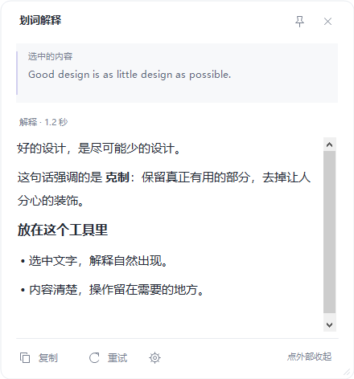

**English** | [简体中文](./readme-zh-cn.md)

<p align="center">
  <a href="https://github.com/guolola/SelectionExplainer">
    
  </a>
</p>

<div align="center">

# SelectionExplainer

<p>
  <strong>Highlight text. Understand it without another click.</strong><br />
  A lightweight Windows assistant that explains selected text using your own model service.<br />
  <sub>Automatic selection · Streaming explanations · Native desktop UI</sub>
</p>

<p>
  <a href="https://github.com/guolola/SelectionExplainer/releases"></a>
  <a href="./docs/guide.md"></a>
  <a href="./LICENSE"></a>
</p>

<p>
  
  
  
  
  <a href="https://github.com/guolola/SelectionExplainer/actions/workflows/ci.yml"></a>
</p>

> Keep reading where you are. Select a sentence, a term or a code snippet and let a small floating window explain it.

</div>

## Overview

**Select text with the mouse and receive an explanation automatically.** There is no extra Explain button or required hotkey. The preview reads a supported application's selection through Windows UI Automation, waits briefly for the selection to settle, and streams the model response next to it.

The desktop interface and default explanation prompt are currently Simplified Chinese. The source and this overview are available in English. This is an early preview; application compatibility and the visual design are still being refined.

### How it works

```text
Select text → Release the mouse → Read the nearby explanation
                                     ↳ Select new text to cancel the old request
```

## Core Capabilities

| Capability | Preview scope |
| --- | --- |
| Automatic explanations | Mouse drag selection or double-click in applications exposing a UI Automation text selection |
| Streaming output | OpenAI-compatible Chat Completions endpoints using SSE; JSON response fallback |
| Bring your own model | Configure the API base URL, model name, key and explanation prompt |
| Native floating window | Rounded card, quoted source, pin/close controls, copy/retry/settings actions and content-aware height |
| Readable answers | Basic headings, bold, lists and code rendered using native RTF after streaming completes |
| Pause and exclude apps | Tray pause/resume and a configurable process-name exclusion list |
| Request cancellation | Selecting new text or dismissing the window cancels the preceding request |
| Local key protection | Windows DPAPI with the current Windows user; no plaintext API key in settings |
| Lightweight distribution | One executable using the installed .NET Framework runtime; no Electron, WebView or bundled model |

### Current boundaries

- Scanned PDFs, images, games and controls that do not expose selected text are not supported. There is no OCR or clipboard fallback.
- Only the selected text is sent; surrounding paragraphs are not collected. Password controls and excluded processes are skipped, but ordinary selected text can still be sensitive.
- The default selection delay is 450 ms and the length limit is 4,000 characters; both are configurable. The request timeout is 90 seconds.
- There is no saved explanation history or auto-start registration. Tray pause is session-only. The basic Markdown formatter is not a complete Markdown engine and does not execute HTML.
- Model quality, latency, availability and API charges depend on your provider. A provider API key is configured separately from any consumer chat subscription.

## Interface Preview



This is an offscreen render of the actual WinForms controls with prepared example text. It is not a desktop capture, a live provider answer or a measured response time. The first UI revision is included in this preview; wider visual and application acceptance remains pending. See [UI references and behavior](docs/context/UI.md).

## Quick Start

### 1. Run the preview

Download the Windows x64 package from [Releases](https://github.com/guolola/SelectionExplainer/releases), extract it and run `SelectionExplainer.exe`. Use Windows 10/11 x64 with .NET Framework 4.8 installed. No installer or administrator privileges are required.

The preview executable is not code-signed. Follow your system's normal review process; the project does not require disabling security protections.

### 2. Configure a provider

On first run, enter the API base URL, model name and API key. Use an HTTPS base address such as `https://api.deepseek.com/v1`; the application appends `/chat/completions`. A compatible loopback endpoint may use HTTP and an empty key.

The settings page explains that selected text is sent to your configured service. [Read the user guide](docs/guide.md) for configuration, privacy and troubleshooting.

### 3. Highlight text

Drag across a short sentence in a supported application, then release the mouse. The floating explanation should appear after the configured delay. Double-click the tray icon to change settings; use its context menu to pause or exit.

## Build from Source

Use Windows PowerShell 5.1 or PowerShell 7 on a Windows x64 computer with .NET Framework 4.8 and its framework compiler. No package restore is needed.

```powershell
git clone https://github.com/guolola/SelectionExplainer.git
cd SelectionExplainer
.\build.ps1 -Test
.\dist\SelectionExplainer.exe
```

The build script uses the system `csc.exe`, installed framework assemblies, the application manifest and the project icon. [Build and release operations](docs/context/RUNBOOK.md) describe the exact prerequisites and packaging steps.

## Project Structure

| Path | Purpose |
| --- | --- |
| `src/` | Desktop application, selection capture, provider client and settings |
| `tests/` | Local HTTP simulation, configuration and request tests |
| `docs/brand/` | Original logo, executable icon and asset provenance |
| `docs/context/` | Current status, decisions, risks and scoped contributor context |
| `.github/workflows/` | Windows build/test and tag-based preview release |
| `scripts/package-release.ps1` | Portable executable, source archives, release metadata and checksums |

## Validation

The local test suite covers endpoint validation, DPAPI roundtrips, atomic settings replacement, streaming Chinese output, JSON fallback, HTTP authentication failures, cancellation, empty responses and oversized selections. It also checks native rich-text formatting, Unicode/RTF escaping, selection preservation and pin/retry event handlers. Tests use synthetic text and a loopback server, without a paid provider.

The project owner reported that the original selection-to-explanation flow worked on their machine. This does not establish compatibility with every application. Local and CI evidence, performance scope and remaining checks are maintained in [current status](docs/context/NOW.md).

## Releases and Roadmap

See [release notes](release-notes.md) for the preview scope and verification limits. Tagged releases publish a Windows portable ZIP, source ZIP/tar.gz, `release.json` and `SHA256SUMS`.

The next focus is validating the revised floating window, broader application compatibility and longer resource measurements. Roadmap items are planned work, not current features.

## Contributing

Read [contributing.md](contributing.md) and use [PROJECT_INDEX.md](PROJECT_INDEX.md) to find task-specific context. Report reproducible issues using the repository templates. Do not include keys or private selected text.

For sensitive reports, follow [security.md](security.md). The project is licensed under [Apache-2.0](LICENSE); see [NOTICE](NOTICE) for attribution and asset information.
